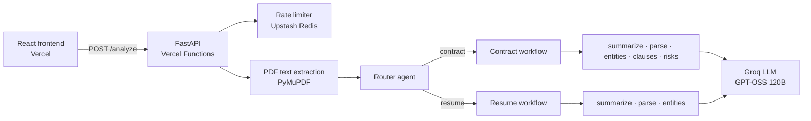

# ParseMind

[](https://github.com/slayplayagrima/ParseMind/actions/workflows/ci.yml)

AI-powered document intelligence. Upload a contract or a resume as a PDF and ParseMind classifies it, then extracts structured data, summaries, risks and recommendations in seconds.

**Live app:** https://parsemind.vercel.app · **API:** https://parse-mind-haix.vercel.app/health

## Features

- **Automatic document routing.** A router agent classifies each upload and sends it to the right workflow.
- **Contract analysis.** Parties, dates, payment terms, obligations, key clauses, risks rated by severity, and recommendations.
- **Resume analysis.** Candidate details, education, experience, projects, skills, strengths, improvements and an ATS score.
- **Entity extraction.** People, organizations, dates, money, locations and technologies across any document.
- **Fast by design.** Each workflow runs its AI skills in parallel, so an analysis takes about as long as its slowest step.
- **Safe for public use.** Upload size and page limits, PDF signature checks, per-IP rate limiting, and readable error messages.

## Architecture



- `backend/app` holds the FastAPI app, routes, middleware and error handling.
- `backend/agents` holds the router agent that picks a workflow.
- `backend/workflows` holds the contract and resume pipelines, which fan out to skills in parallel.
- `backend/skills` holds single-purpose LLM tasks, with prompts in `backend/prompts`.
- `backend/services` holds the LLM client, PDF extraction and rate limiter.
- `frontend/src` holds the React app: upload, loading and results pages.

## Tech stack

| Layer | Tools |
| --- | --- |
| Frontend | React 18, TypeScript, Vite, MUI, Tailwind CSS, React Router, Axios |
| Backend | Python 3.13, FastAPI, Pydantic, pydantic-settings, PyMuPDF |
| AI | Groq API, GPT-OSS 120B (`openai/gpt-oss-120b`) |
| Infrastructure | Vercel (frontend and serverless backend), Upstash Redis |
| Quality | pytest, Vitest, Testing Library, ruff, ESLint, GitHub Actions |

## Running locally

**Backend**

```bash
cd backend
python3 -m venv .venv && source .venv/bin/activate
pip install -r requirements-dev.txt
cp .env.example .env   # then add your GROQ_API_KEY
uvicorn app.main:app --reload
```

The API runs at http://127.0.0.1:8000, with interactive docs at http://127.0.0.1:8000/docs.

**Frontend**

```bash
cd frontend
npm install
cp .env.example .env.local
npm run dev
```

The app runs at http://localhost:5173.

## Environment variables

Backend (`backend/.env`):

| Variable | Required | Default | Purpose |
| --- | --- | --- | --- |
| `GROQ_API_KEY` | Yes | | Groq API key |
| `GROQ_MODEL` | No | `openai/gpt-oss-120b` | Model used by every skill |
| `LLM_MAX_TOKENS` | No | `8192` | Max output tokens per call; reasoning models need room to think |
| `LLM_TIMEOUT_SECONDS` | No | `30` | Timeout per LLM call |
| `LLM_MAX_RETRIES` | No | `2` | Retries with backoff on errors and rate limits |
| `MAX_UPLOAD_MB` | No | `4` | Upload size limit |
| `MAX_PDF_PAGES` | No | `50` | Page limit per PDF |
| `UPSTASH_REDIS_REST_URL` | No | | Enables rate limiting |
| `UPSTASH_REDIS_REST_TOKEN` | No | | Enables rate limiting |
| `RATE_LIMIT_REQUESTS` | No | `10` | Analyses allowed per IP per window |
| `RATE_LIMIT_WINDOW_SECONDS` | No | `3600` | Rate limit window |
| `ALLOWED_ORIGINS` | No | localhost + production | Comma-separated CORS origins |

Frontend (`frontend/.env.local`): `VITE_API_URL`, the backend URL.

Settings are validated at startup, so a missing key or invalid value stops the app with a clear error.

## Testing

Every push and pull request runs the full suite on GitHub Actions.

```bash
# Backend: 40 tests, ~93% coverage
cd backend
ruff check . && ruff format --check .
pytest --cov=app --cov=services --cov=workflows --cov=config

# Frontend: 20 tests
cd frontend
npm run lint
npm run coverage
```

Tests run offline: the Groq API and Upstash are faked, so they're fast and free. Live API checks live in `backend/scripts/smoke`.

## Deployment

Both parts deploy to Vercel from this repository as two projects:

| Project | Root directory | Notes |
| --- | --- | --- |
| Frontend | `frontend` | Set `VITE_API_URL` to the backend URL |
| Backend | `backend` | FastAPI is detected from `app/main.py`; config in `backend/vercel.json` |

Vercel Functions cap request bodies at 4.5 MB, which is why uploads are limited to 4 MB. Add the backend environment variables in the Vercel project settings, and redeploy after changing them.
